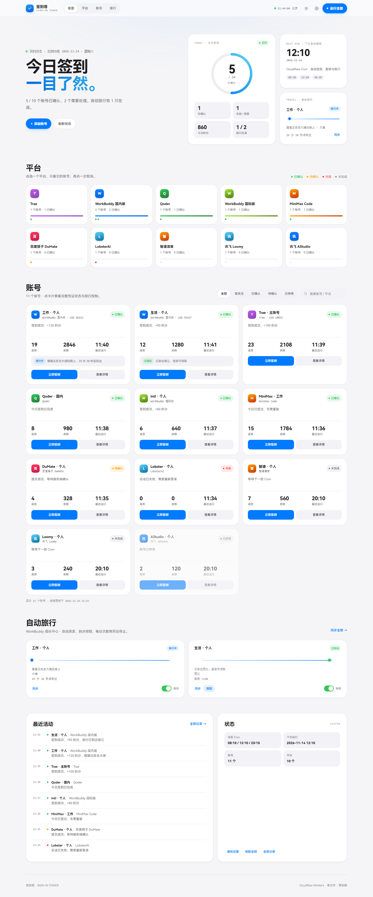
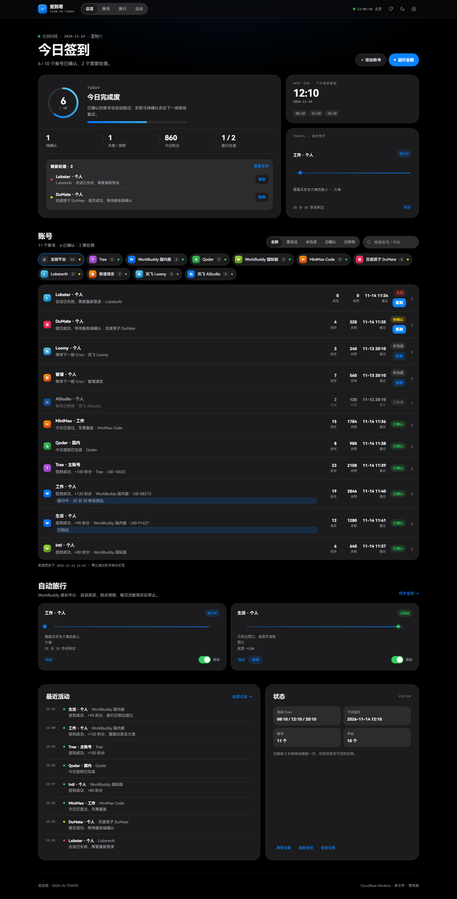

<div align="center">

# 签到塔 · SIGN-IN TOWER

**十个 AI 工具，一座值班塔。**

单文件 Cloudflare Worker：每日签到、令牌续期、服务端复核、WorkBuddy 自动旅行，全部收进一块安静的控制台。

<br>


<br>

| 日间模式 | 夜间模式 |
| :---: | :---: |
|  |  |

</div>

---

## 目录

- [一、这座塔是什么](#一这座塔是什么)
- [二、能力总览](#二能力总览)
- [三、五条设计原则](#三设计原则)
- [四、五分钟部署](#四五分钟部署)
- [五、第一次进入](#五第一次进入)
- [六、控制台导览](#六控制台导览)
- [七、添加账号](#七添加账号)
- [八、WorkBuddy 自动旅行](#八workbuddy-自动旅行)
- [九、定时任务](#九定时任务)
- [十、签到结果通知](#十签到结果通知)
- [十一、接口速查](#十一接口速查)
- [十二、架构与数据](#十二架构与数据)
- [十三、安全设计](#十三安全设计)
- [十四、常见问题](#十四常见问题)
- [十五、已知限制](#十五已知限制)
- [十六、风险提示](#十六风险提示)
- [十七、仓库结构](#十七仓库结构)
- [十八、参与贡献](#十八参与贡献)
- [十九、许可证](#十九许可证)

---

## 一、这座塔是什么

每天要点十次签到，散落在十个网页、客户端和小程序里。签到塔把这件事收成一张表：

- **一处值守**：十个平台共用一套部署、一个控制台、一条定时任务，账号按平台前缀隔离在同一个 KV 里。
- **只认服务端**：领取接口返回 200 只算「已提交」。账号会回查签到状态 / 活动状态，看到今日已签才写成功日期。
- **不断签**：能复用未过期的 accessToken 就不轮换；必须续期时立刻落盘；失败与待确认账号在同一轮和后续 Cron 里继续重试。
- **顺手旅行**：WorkBuddy 国内版支持成长中心的「派猫猫旅行」——自动派发、到点领奖、每日次数用尽后停止，状态直接写在账号详情、概览旅行卡和下方「自动旅行」区。

页面本身也是一块安静的控制台：概览、平台胶囊、账号列表、状态点与详情弹窗。没有卡片墙，默认浅色，右上角一键切换深色。

---

## 二、能力总览

| 平台 | 每日内容 | 添加方式 | 复核方式 | 状态 |
| --- | --- | --- | --- | --- |
| **Trae** | 每日积分 | 抖音扫码 + 粘贴一次回调链接 | 回查积分/签到状态 | 已实测 |
| **WorkBuddy**（国内版） | 每日签到 + **自动旅行** | 微信扫码 | 回查 `today_checked_in`；旅行回查 `state` | 已实测 |
| **Qoder**（国内 / 国际） | 旧版每日签到 + 活动平台 Credits | 官网设备授权，或粘贴 PAT | 回查 `CLAIMED` / 今日已签 | 双通道已补 |
| **WorkBuddy 国际版** | 档期内每日领取 | Google / GitHub / X 网页授权，或粘贴 token | 回查活动状态 | 待实测 |
| **MiniMax Code** | 每日 OP 积分 | 粘贴 accessToken / refreshToken | 回查领取结果 | 待实测 |
| **百度搭子 DuMate** | 每日登录奖励 500 积分 | 粘贴 Cookie | 回查积分变化 | 待实测 |
| **LobsterAI** | 每日积分礼 100 积分 | 粘贴 accessToken | 回查领取结果 | 待实测 |
| **智谱清言** | 每日登录积分 | 粘贴 `chatglm_token` | 回查余额/状态 | 待实测 |
| **讯飞 Loomy** | 每日额度池重置 | 粘贴 token | 回查额度池 | 待实测 |
| **讯飞 AStudio** | 每日登录积分 | 手机号 + 密码，或粘贴 Cookie | 回查余额 | 待实测 |

「已实测」表示当前实现已在真实账号上跑通；「待实测」表示协议按官方客户端/网页整理，但未在本部署用真实账号复核。页面会如实标出，不把未验证写成成功。

---

## 三、设计原则

### 1. 成功 = 服务端点头

每个平台都有两层判定：

1. **提交层**：签到/领取接口返回 `code = 0`。
2. **确认层**：回查状态接口，看到今日已签、`CLAIMED`、积分到账或活动状态变化。

只有确认层通过，才写 `verifiedDate = 今天`。提交成功但确认层未通过时，状态是 **待确认**，下一轮 Cron 继续复查，不会伪装成成功。

### 2. 令牌不被浪费

WorkBuddy / Qoder 的 refreshToken 是一次性轮换的。旧实现每轮无条件刷新，一旦响应丢失或两轮撞车，旧 RT 立刻作废，于是「显示成功但第二天断签」。

现在的顺序是：

```
accessToken 未过期 → 直接用
临期（< 5 分钟）→ 续期一次，响应立刻加密落盘
业务请求 401/403 → 强制续期一次再重试
续期明确失败（会话失效）→ 标记 token_dead，等待重新登录
```

### 3. 同一轮有补救，跨轮有班次

- 同一轮里失败 / 待确认的账号，等 2.5 秒再补跑一次。
- 建议配 3 条 Cron（08:10 / 12:10 / 20:10）。已验证账号自动跳过，失败账号继续重试。
- 接口幂等：今天已签会返回「已签」，多跑几次不会重复加分。

### 4. 单文件、零依赖、零构建

全部代码在 `worker.js`，没有 `import`、没有 `package.json`、没有构建产物。粘进 Cloudflare 网页控制台就能运行；也可以用 `wrangler` 部署。

### 5. 默认加密

KV 里不存在明文令牌。每条账号记录用 AES-256-GCM 单独加密，密钥由 `MASTER_KEY` 经 HKDF-SHA256 按平台派生。接口响应里永远不返回令牌、Cookie、私钥。

---

## 四、五分钟部署

全程在 Cloudflare 网页控制台完成。

### 1. 建 Worker

1. 打开 [Cloudflare Dashboard](https://dash.cloudflare.com/) → **Workers & Pages** → **Create**
2. 起名，例如 `sign-in-tower`
3. 创建后点 **Edit code**
4. 把 `worker.js` 全文粘进去 → **Deploy**

### 2. 加绑定

回到 Worker 设置页：

| 类型 | 名称 | 值 |
| --- | --- | --- |
| KV Namespace 绑定 | `KV` | 先到 **Storage & Databases → KV** 新建命名空间，再回来选中 |
| Secret | `MASTER_KEY` | 32 字节随机值的 base64，所有平台共用 |
| Secret | `ADMIN_TOKEN` | 控制台登录口令 |
| Secret | `CRON_SECRET` | 可选。`/cron` 独立口令，不配则回落到 `ADMIN_TOKEN` |
| Secret | `CHATGLM_SIGN_SECRET` | 可选。覆盖智谱签名盐；默认值已内置 |
| 变量 | `CHECKIN_CRON` | 可选。首次 Cron 触发前的展示占位，填 `08:10` |

> `MASTER_KEY` 和 `ADMIN_TOKEN` 要建成 **Secret**，不要建成普通变量。普通变量在后台明文可读，还会留在部署历史里。

生成主密钥：浏览器 F12 → Console，执行

```js
btoa(String.fromCharCode(...crypto.getRandomValues(new Uint8Array(32))))
```

32 字节的 base64 一定是 **44 个字符、以 `=` 结尾**。长度不对就是复制漏了。

> `MASTER_KEY` 丢失 = KV 里的令牌全部解不开，只能重新扫码/重新粘贴。存进密码管理器。

### 3. 加 Cron

**Settings → Triggers → Cron Triggers**：

| Cron（UTC） | 北京时间 | 作用 |
| --- | --- | --- |
| `10 0 * * *` | 08:10 | 早班全量签到 + 出发旅行 + 固定日报 |
| `10 4 * * *` | 12:10 | 重试失败/待确认；通常正好领取旅行奖励 |
| `10 12 * * *` | 20:10 | 晚间兜底重试 + 旅行收尾 |

### 4. 可选：用 GitHub 自动部署

仓库里只有模板 `wrangler.toml.example`，没有 `wrangler.toml`。直接跑 `npx wrangler deploy` 时，wrangler 找不到配置会退化成静态站点检测，报 `Could not detect a directory containing static files`。让部署命令自己生成配置：

| 设置项 | 值 |
| --- | --- |
| Build command | 留空 |
| Deploy command | `test -n "$KV_NAMESPACE_ID" && cp wrangler.toml.example wrangler.toml && sed -i "s/__KV_NAMESPACE_ID__/$KV_NAMESPACE_ID/g" wrangler.toml && npx wrangler deploy` |
| Environment variables | `KV_NAMESPACE_ID`（加密）＝ 你的 KV 命名空间 id |

生成配置要写在 **Deploy command**，不要写在 Build command：Workers Builds 在 Direct Deploy 模式下不跑构建命令，日志里只会出现 `Executing user deploy command`。

---

## 五、第一次进入

打开 Worker 域名，会先看到「值班口令」。输入 `ADMIN_TOKEN` 后进入控制台。

口令只存在浏览器 `localStorage`，Worker 不落盘、不下发 Cookie。换设备或清缓存后需要重新输入。想换口令：设置 → 更换口令；或者直接改 Cloudflare 上的 `ADMIN_TOKEN`。

---

## 六、控制台导览

页面是「签到塔」的 Apple 风格控制台，所有样式内联，不请求任何外部字体、图片或脚本。默认浅色，可切换深色。

### 概览

- **页面标题**：日期与「今日签到」，右侧是「＋ 添加账号」和「运行全部」。
- **今日完成度**：环形进度 + 线性进度，配上待确认、失败 / 受限、今日积分、旅行在途四个指标。
- **需要处理**：直接列出失败或待确认的账号，点「签到」立即重试；「查看全部」跳到对应筛选。
- **下次签到 / 自动旅行**：右侧显示下一班 Cron 时间与旅行摘要。
- **平台筛选**：全部平台 + 各平台胶囊，带账号数量与状态点；移动端可横向滑动。
- **账号列表**：需处理的账号排在最前；每行显示状态、最近消息、连签、余额与最近运行。点整行打开详情弹窗，未确认的账号可在行内直接「签到」。
- **筛选与搜索**：全部 / 需关注 / 未完成 / 已确认 / 已停用，支持按账号名、平台、消息搜索。

### 账号详情

点账号行打开弹窗：顶部是状态、最近消息与最近确认；下面依次是最近运行、连签、累计、本期累计、真实余额、今日获得与凭证类型；WorkBuddy 账号还会多出一块「成长中心 · 派猫猫旅行」。底部提供「立即签到 / 刷新状态 / 改名 / 停用 / 删除」。

### 页面下方

| 区块 | 内容 |
| --- | --- |
| **自动旅行** | 每个 WorkBuddy 账号的旅行状态、地点、到达倒计时、奖励、同步/领取/派发按钮、自动旅行开关与同步全部 |
| **最近活动** | 最近 7 条签到结果，带平台、状态点和说明；点「查看全部记录」打开完整日志 |
| **状态** | 当前 Cron、下次运行、账号数、平台数；通知设置、刷新全部、全部记录 |

### 状态标签

| 标签 | 含义 |
| --- | --- |
| 已确认 | 服务端回查确认今天已签 |
| 待确认 | 提交成功，但服务端状态还没确认；后续 Cron 继续复查 |
| 未完成 | 今天还没跑，或还没到定时时间 |
| 限流 | 平台返回 429 / 冷却中，到点自动重试 |
| 失败 | 请求出错或凭证失效，详情里有原因 |
| 无活动 | 平台明确返回当前没有活动档期，不是凭证问题 |
| 已停用 | 账号开关关闭，不参与定时和批量签到 |

### 主题

浅色是默认主题。右上角的太阳 / 月亮按钮切换深色，选择保存在本地。页面无外部资源，样式随 Worker 一起部署。

---

## 七、添加账号

页面标题右侧 **「＋ 添加账号」**，先选平台，再按提示操作。

### Trae：抖音扫码

1. 选 **Trae** → 「打开授权页」
2. 抖音扫码并确认
3. 浏览器会停在一个**打不开的** `http://127.0.0.1:17388/authorize?…` 页面 —— 这是正常的，本机没有服务在监听
4. 复制地址栏整段链接，回控制台粘贴到「回调地址」，会自动绑定

链接里带着一次性授权码。Worker 拿它换 refreshToken 并加密入库。设备密钥（ECDSA P-256）由 Worker 现场生成并保存，不需要装 Trae 客户端。

> Trae 只把授权码回送到 `127.0.0.1`，云端 Worker 访问不到你电脑的端口，所以最后一步只能由人粘一次。一个账号只需做一次。

### WorkBuddy 国内版：微信扫码

1. 选 **WorkBuddy** → 「打开登录页」
2. 新窗口打开官方登录页，二维码由官方页面渲染，本服务不接触微信信息
3. 微信扫码 → 手机确认
4. Worker 轮询到结果 → 令牌加密入库 → 账号自动出现

二维码有效期约 5–6 分钟，超时重新点一次。

### Qoder：设备授权或 PAT

国内版 `qoder.com.cn`（API `openapi.qoder.com.cn`）与国际版 `qoder.com`（API `openapi.qoder.sh`）账号不互通。

- **设备授权**：选 **Qoder** → 「国内版授权」或「国际版授权」→ 官方页面登录确认 → 自动入库。
- **PAT**：在 Qoder 账号设置 → integrations 生成 `pt-` 开头的 Personal Access Token，粘到「Personal Access Token」，选好区域后添加。

签到同时走两条通道：旧版每日签到（`daily-check-in/status` → `claim`）与活动平台（`campaigns` → `claim`）。活动列表偶发空时会退避重取；领取后回查 `CLAIMED`；同一设备/身份下其他账号已领取时显示「同人去重」并冷却 6 小时。

> 不要自行拼 `cosy-machine*` 六件套。服务端会把派生出来的机器头判定为非官方客户端，把每日 Credits 活动整条过滤掉。

### MiniMax Code：粘 OAuth 令牌

从 `~/.minimax/auth/prod/cn/mcode-public/auth.json` 取 `accessToken`（`mmoat_…`）与 `refreshToken`（`mmort_…`），两项都粘上。`device_id` / `uuid` / `user_id` 可留空（自动派生 / 从 JWT 取）。

> accessToken 只有 1 小时寿命；填了 refreshToken 会自动续期并写回。签到需要桌面端签名，已按 3.1.4 复刻。

### 百度搭子 DuMate：粘 Cookie

浏览器登录 `console.bce.baidu.com`，F12 → Network → 任意请求 → 复制完整 `Cookie`（至少包含 `BDUSS` 与 `bce-user-info`）。`csrftoken` 可留空，会自动从 `bce-user-info` 取。

### LobsterAI：粘 accessToken

打开 LobsterAI 桌面端登录，用 SQLite 打开 `%APPDATA%\LobsterAI\lobsterai.sqlite`，执行 `SELECT value FROM kv WHERE key='auth_tokens'`，取 JSON 里的 `accessToken`。

### WorkBuddy 国际版：网页授权或 token

选 **WorkBuddy 国际版** → 「打开授权页」，用 Google / GitHub / X 登录；或把 `access_token` 粘进输入框。

> 活动按档期开放。没有档期时返回 `10001 签到活动未开启或已过期`，页面显示「无活动」，不是凭证失效。

### 智谱清言：粘 chatglm_token

浏览器登录 `chatglm.cn` → F12 → Application → Cookies → 复制 `chatglm_token`。有 `chatglm_refresh_token` 一并填上。

> 签名盐已内置。请求头带 `X-Timestamp` / `X-Nonce` / `X-Sign = md5(ts-nonce-secret)`。客户端更新导致签名失败时，用 Secret `CHATGLM_SIGN_SECRET` 覆盖。

### 讯飞 Loomy：粘 token

从 Loomy 客户端或网页的请求头 / Cookie 里取 `token`。Loomy 的「签到」是**每日额度池重置**，不是加积分。

### 讯飞 AStudio：手机号密码或 Cookie

推荐「手机号密码」：输入 11 位手机号与密码，登录成功会先查一次余额验活，再入库。密码只在本次请求内存里用一次，不落盘、不进日志。

如果讯飞要求滑块（通常是密码输错过一次触发的），改用「粘贴 Cookie」：浏览器登录 AStudio → F12 → Network → 复制完整 Cookie，填到 `session`。只填 `token=` 的值时程序会自动拼成 Cookie。

### 备注名

账号备注优先取自昵称；取不到时是平台名 + 随机后缀。点账号行打开详情 → 「改名」，输入后确认即可。

---

## 八、WorkBuddy 自动旅行

「派猫猫旅行」是 WorkBuddy 国内版成长中心的活动。签到塔把它做成了和签到同一套调度：

- 每天第一次运行：如果状态是 `idle` 且次数未用完，自动选第一个可用地点派出。
- 之后的运行：`traveling` 只等待；`arrived` 自动领取奖励；`idle + daily_limit_reached` 视为「累了，明天再来吧」，标记今日完成。
- 每个 WorkBuddy 账号默认开启自动旅行，可在下方「自动旅行」区或账号详情里单独关闭。
- 手动按钮：**同步**（按当前状态决定派发/领取）、**派发**（强制尝试出发）、**领取**（只在已到达时可用）。

### 状态机

```
idle ──(depart)──▶ traveling ──(到点)──▶ arrived ──(claim)──▶ idle
  │                                                          
  └─ daily_limit_reached = true ──▶ 今日完成（明天再来）
```

判定完全以服务端 `data.state` 为准：

| 服务端状态 | 页面 | 动作 |
| --- | --- | --- |
| `idle`，未达上限 | 未派发 | 自动派发 |
| `traveling` | 旅行中 | 等待；显示到达倒计时 |
| `arrived` | 已到达 | 自动领取奖励 |
| `idle` + `daily_limit_reached` | 今日完成 | 不再派发 |
| 缺 `state` / 未知 `state` | 同步失败 | 不默认成 idle，不误标已领 |
| `no active buddy` | 无 Buddy | 可重试；先去 WorkBuddy 创建 Buddy |
| `location not available` | 地点不可用 | 换下一个地点；全部失败才报错 |
| HTTP 429 | 失败（限流） | 不当作「今日已派」，后续班次重试 |

### 时间安排

| 时间 | 会发生什么 |
| --- | --- |
| 08:10 | 签到 + 派发旅行 |
| 12:10 | 签到重试 + 旅行到达后自动领取 |
| 20:10 | 晚间兜底 + 旅行收尾 |

旅行接口与签到网关同账号体系，但挂在 `www.codebuddy.cn/activity/growth/buddy/travel`。请求会带 `X-User-Id`、`X-Client-Platform: web`、`Origin` / `Referer`，401 时先续期再重试；主域名无路由时会回落到备用网关。

### 数据

旅行状态保存在同一条加密账号记录里（`travel` 字段），包含：

```json
{
  "label": "traveling",
  "state": "traveling",
  "locationName": "海边车站",
  "arriveAt": 1788964568000,
  "rewardCredit": 8,
  "dailyLimit": false,
  "message": "猫猫正在路上",
  "checkedAt": 1788963000000,
  "claimedAt": 0
}
```

`label` 只用于展示；真正的判定始终看服务端的 `state` 与 `daily_limit_reached`。

---

## 九、定时任务

Cloudflare Cron 只认 UTC，北京 = UTC + 8。

| 设置 | Cron | 北京时间 | 作用 |
| --- | --- | --- | --- |
| 必设 | `10 0 * * *` | 08:10 | 全量签到 + 派发旅行 + 日报 |
| 强烈建议 | `10 4 * * *` | 12:10 | 重试 + 领取旅行奖励 |
| 强烈建议 | `10 12 * * *` | 20:10 | 晚间兜底 + 旅行收尾 |

只配 08:10 也能用，但遇到网络抖动、令牌续期撞车或上游状态延迟时，当天没有第二次补救机会。多配几条不会重复加分。

### 外部定时器

不想用 Cloudflare 自带 Cron，可以从外面调 `/cron`：

```bash
curl -X POST "https://你的域名/cron" \
  -H "X-Cron-Secret: 你的CRON_SECRET"
```

```bash
# 也可以放 query（GET / POST 都行）
curl "https://你的域名/cron?key=你的CRON_SECRET"
```

返回各平台汇总，WorkBuddy 额外带 `travels` 与 `travelSummary`。

---

## 十、签到结果通知

设置 → 通知通道。Telegram 与 QQ 官方机器人各自独立，填完可以「发送测试」。

| 渠道 | 需要 | 说明 |
| --- | --- | --- |
| Telegram | Bot Token、Chat ID | 找 [@BotFather](https://t.me/BotFather) 建 bot；先给 bot 发消息，再用 `getUpdates` 拿 `chat.id` |
| QQ 官方机器人 | AppID、AppSecret、OpenID | 到 [q.qq.com](https://q.qq.com) 建机器人；OpenID 用页面里的命令在本机取 |

取 QQ OpenID 的脚本随 Worker 一起提供：

```bash
# Windows cmd（PowerShell 里 curl 是别名，不认 -O）
curl.exe -O https://你的域名/qq/openid-helper.mjs && node openid-helper.mjs <AppID> <AppSecret>

# macOS / Linux
curl -O https://你的域名/qq/openid-helper.mjs && node openid-helper.mjs <AppID> <AppSecret>
```

脚本需要 Node 22+（自带 WebSocket）。连上网关后 60 秒内用手机 QQ 私聊一次机器人，就会打印 `user_openid`。

每轮有实际结果时推一条汇总，通道失败不影响签到。

---

## 十一、接口速查

管理接口认三种口令：`X-Admin-Token: <token>`、`Authorization: Bearer <token>`、`?token=<token>`。

### 聚合接口

| 方法 | 路径 | 说明 |
| --- | --- | --- |
| GET | `/` | 控制台 |
| GET | `/api/ping` | 校验口令 |
| GET | `/api/meta` | 平台元数据、字段、可用状态、Cron 展示值 |
| GET | `/api/overview` | 所有平台账号 + 今日统计 + 下次运行 + 旅行状态 |
| GET | `/api/history?limit=200` | 运行历史（最多 300 条） |
| POST | `/api/history/clear` | 清空运行历史 |
| POST | `/api/run-all` | 所有平台一起跑；`?force=1` 强制重跑 |
| POST | `/api/platforms/run` | body `{"platform":"qoder","force":true}` |
| POST | `/api/accounts/sign` | body `{"platform":"...","id":"...","force":true}` |
| POST | `/api/accounts/refresh` | body `{"platform":"...","id":"..."}`，只查状态/余额 |
| POST | `/api/refresh-all` | 刷新所有启用账号 |
| POST | `/api/accounts/add` | body `{"platform":"...","label":"...","creds":{...}}` |
| POST | `/api/accounts/remove` | body `{"platform":"...","id":"..."}` |
| POST | `/api/accounts/rename` | body `{"platform":"...","id":"...","label":"..."}` |
| POST | `/api/accounts/enable` | body `{"platform":"...","id":"...","enabled":false}` |
| POST | `/api/accounts/travel` | WorkBuddy 旅行：`{"platform":"workbuddy","id":"...","action":"sync"}` |
| GET | `/api/notify` | 读取通知配置 |
| POST | `/api/notify` | 保存通知配置；空字段表示沿用旧值 |
| POST | `/api/notify/test` | 用假数据向已配置渠道各发一条 |
| GET | `/qq/openid-helper.mjs` | QQ openid 助手脚本 |
| POST | `/cron` | 定时入口，口令走 `X-Cron-Secret` 或 `?key=` |

### 旅行动作

`POST /api/accounts/travel` 的 `action`：

| action | 行为 |
| --- | --- |
| `sync` | 按服务端状态决定：`arrived` 领取、`idle` 按自动开关派发、`traveling` 等待 |
| `depart` | 强制尝试派发（仍遵守每日上限） |
| `claim` | 只在已到达时领取，不改自动开关 |
| `auto-on` / `auto-off` | 单独打开/关闭该账号的自动旅行 |
| `run` | 同步全部 WorkBuddy 账号（忽略自动开关过滤） |

### 平台命名空间

| 前缀 | 平台 |
| --- | --- |
| `/trae/api/*` | Trae |
| `/wb/api/*` | WorkBuddy 国内版 |
| `/wbi/api/*` | WorkBuddy 国际版 |
| `/qoder/api/*` | Qoder |
| `/minimax/api/*` | MiniMax Code |
| `/dumate/api/*` | 百度搭子 DuMate |
| `/lobster/api/*` | LobsterAI |
| `/zhipu/api/*` | 智谱清言 |
| `/loomy/api/*` | 讯飞 Loomy |
| `/astudio/api/*` | 讯飞 AStudio |

每个命名空间都有 `GET /api/list`、`POST /api/run`、`POST /api/remove`、`POST /api/rename`、`POST /api/refresh`、`POST /api/enable`。支持粘贴凭证的平台还有 `POST /api/add`；WorkBuddy 国际版有 `POST /api/login/start` / `GET /api/login/poll`；AStudio 有 `POST /api/login/password`；Qoder 有 `POST /api/login/start`（返回 `nonce` 与授权页）与 `GET /api/login/poll?nonce=`；WorkBuddy 还有 `POST /api/travel`。

Trae 扫码：

| 方法 | 路径 | 说明 |
| --- | --- | --- |
| POST | `/trae/api/login/start` | 生成抖音授权链接 |
| GET | `/trae/api/login/poll?trace=` | 查询扫码结果 |
| POST | `/trae/api/login/claim` | body `{"url":"..."}`，粘贴回调链接完成绑定 |

> `force=1` 只跳过「今天签过就不请求」的本地判断；服务端本身幂等。

---

## 十二、架构与数据

`worker.js` 从上到下分十段：

1. **公共工具**：编码、时间、HTTP、MD5、AES-256-GCM 保险箱。
2. **Trae**：设备身份、抖音扫码、签到与积分。
3. **WorkBuddy 国内版**：扫码、令牌轮换、签到、**成长中心旅行**。
4. **Qoder**：国内/国际双区域、设备授权、旧版签到 + 活动平台。
5. **通用平台工厂**：WorkBuddy 国际版、智谱、Loomy、AStudio。
6. **自定义多步平台**：MiniMax Code、百度搭子 DuMate、LobsterAI。
7. **外壳**：平台注册表、聚合接口、通知、Cron。
8. **控制台页面**：签到塔的单文件 HTML/CSS/JS。
9. **入口**：`fetch` / `scheduled`。
10. **导出**：Cloudflare Workers 默认导出。

### KV 前缀与加密 info

| 平台 | KV 前缀 | HKDF info |
| --- | --- | --- |
| Trae | `trae:` | `trae-signin/v1/account` |
| WorkBuddy | `wb:` | `wb-signin/v1/account` |
| Qoder | `qoder:` | `qoder-signin/v1/account` |
| WorkBuddy 国际版 | `wbi:` | `wbintl-signin/v1/account` |
| MiniMax Code | `minimax:` | `minimax-signin/v1/account` |
| 百度搭子 DuMate | `dumate:` | `dumate-signin/v1/account` |
| LobsterAI | `lobster:` | `lobster-signin/v1/account` |
| 智谱清言 | `zhipu:` | `zhipu-signin/v1/account` |
| 讯飞 Loomy | `loomy:` | `loomy-signin/v1/account` |
| 讯飞 AStudio | `astudio:` | `astudio-signin/v1/account` |

### 历史与 Cron

- 运行历史存在 `history:runs`，最多 300 条；清空只删日志。
- 最近使用的 Cron 表达式存在 `meta:crons`，用于计算下次运行时间。
- 通知配置存在 `notify:config`，与账号凭证一样加密。

### 备份

KV 里是密文，备份时务必同时保存 `MASTER_KEY`。换 `MASTER_KEY` 后旧记录全部解不开。

### 兼容

老账号字段会按默认值补齐：缺 `enabled` 按启用处理；第一次刷新/签到后补上新字段。签到的「成功」语义从旧的本地乐观标记切换到 `verifiedDate` 服务端确认；旧的成功日期不沿用。

---

## 十三、安全设计

- KV 里只存 **AES-256-GCM 密文**，每条记录随机 salt / IV，密钥由 `MASTER_KEY` 经 HKDF-SHA256 派生。
- 接口响应不返回令牌、Cookie、私钥，连前缀都不给。
- 登录口令与账号令牌分离；口令比较使用定长比较，避免时序侧信道。
- 登录口令只存在浏览器 `localStorage`。
- AStudio 密码只在单次请求内存里换会话，不保存、不写日志。
- 页面零外部资源引用，不加载第三方脚本或字体。
- 每个平台使用独立 HKDF info；一个平台的密文被解开不会影响其他平台。

> 边界：令牌在 Worker 内存里必然有一刻是明文。云端能看到什么取决于你是否信任它。介意就部署到自己的 Cloudflare 账号下。

---

## 十四、常见问题

| 现象 | 原因 | 处理 |
| --- | --- | --- |
| 登录提示「登录密码不正确」 | `ADMIN_TOKEN` 填错 | 检查空格 |
| 提示 `未配置 ADMIN_TOKEN` | Secret 没建 | 补建，名称必须完全一致 |
| 提示 `缺少 MASTER_KEY` | Secret 没建或名称拼错 | 名称必须完全一致 |
| 提示 `MASTER_KEY 必须是 32 字节` | 主密钥复制不全 | 重新生成，44 字符且以 `=` 结尾 |
| 提示 `未绑定 KV` | KV 没绑或绑定名写错 | 绑定名必须完全等于 `KV` |
| **WorkBuddy 显示成功但第二天断签** | accessToken 过期、refreshToken 轮换丢失 | 已改为「能复用就复用、续期立刻落盘、401 再续一次」；建议配 3 条 Cron |
| **WorkBuddy 显示待确认** | 提交成功但状态接口还没记账 | 正常保护；后续 Cron 自动复查，不要手动反复强签 |
| **Qoder 完全签不上** | 只走旧版每日签到，或活动列表解析失败 | 已补双通道、空列表退避重取、领取后回查；活动状态 `CLAIMED` 才算成功 |
| Qoder 显示「同人去重」 | 同一设备/身份下其他账号本轮已领 | 冷却 6 小时后再试；不要所有账号共用同一设备 |
| **旅行一直显示未派发** | 自动旅行关闭，或没有 Buddy，或不在国内版 | 打开自动开关；先在 WorkBuddy 创建 Buddy；国际版没有该活动 |
| 旅行显示「今日完成」 | 官网返回 `daily_limit_reached` | 今天次数用完，明天再来，不是失败 |
| 旅行显示「同步失败」 | 状态接口缺 `state` / 网络 / 401 | 点「同步」重试；仍失败看 Worker Logs |
| WorkBuddy 国际版显示「无活动」 | 当前没有活动档期（10001） | 不是失败，等档期 |
| 国际版粘国内版 token 报 401 | 两站登录态不通用 | 换 `www.workbuddy.ai` 的 token / 授权 |
| AStudio 密码登录提示要滑块 | 讯飞风控 | 改用「粘贴 Cookie」 |
| Trae 扫码后停在「无法访问此网站」 | 官网只回送 `127.0.0.1` | 复制地址栏整段链接，回控制台粘贴 |
| 智谱签名失败 | 客户端签名盐更新 | 用 `CHATGLM_SIGN_SECRET` 覆盖 |
| 一直没动静 | Cron 没配 / 时区填错 | 检查 Triggers，注意 UTC |
| `/cron` 返回 401 | 口令不对 | 用 `CRON_SECRET`，未配置时回落到 `ADMIN_TOKEN` |

排查看实时日志：Worker 详情页 → **Logs**。

---

## 十五、已知限制

1. 除 Trae / WorkBuddy 外，平台接口来自官方客户端/网页逆向，客户端升级可能改路径或参数；页面会把未实测平台标出来。
2. 智谱签名盐、MiniMax 签名版本会随客户端更新；已提供 `CHATGLM_SIGN_SECRET` 与版本字段覆盖。
3. Qoder 国际版可能需要真实 UMID 机器身份；本项目不发 `cosy-machine*`，拿不到活动时会明确显示「无活动 / 待确认」。
4. WorkBuddy 自动旅行仅国内版开放；国际版没有成长中心。
5. 旅行依赖服务端 `state`，官方接口字段变更时需要跟进适配；缺字段时宁可报错也不误标完成。
6. WorkBuddy 国际版活动按档期开放；AStudio 密码登录可能被滑块拦截；DuMate / LobsterAI 的 Cookie / token 过期后需重新粘贴。
7. Trae 授权码只能落到 `127.0.0.1`，加账号最后一步必须手动粘贴一次。
8. 扫码依赖官方登录页；登录页改版或限制非客户端来源时可能失效。
9. 只做签到、领积分与 WorkBuddy 旅行，不做兑换、盲盒等更复杂的成长中心玩法。
10. 免费额度足够：Workers 10 万请求/天，KV 10 万读 / 1000 写 / 天；一天几轮连零头都用不到。

---

## 十六、风险提示

本项目为非官方工具，与 Trae、WorkBuddy、CodeBuddy、Qoder、智谱、讯飞、MiniMax、百度及其所属公司均无任何隶属关系。接口从各自客户端/网页整理，使用风险自负。

自动化签到可能涉及服务条款。建议只给自己的账号使用，不要做多账号刷积分——规模一大更容易被风控识别。项目提供多账号能力是为了方便管理你自己的号，不是鼓励滥用。

---

## 十七、仓库结构

```
.
├── worker.js                # 全部代码：十个平台 + 自动旅行 + 控制台 + 定时任务
├── wrangler.toml.example    # 可选：命令行部署的绑定模板
├── docs/screenshots/        # 文档截图（演示数据，不含真实账号）
├── LICENSE                  # MIT
├── SECURITY.md              # 漏洞报告方式
└── CONTRIBUTING.md          # 新增平台适配器的约定
```

---

## 十八、参与贡献

- 新增平台：写一个适配器对象，提供 `meta` / `normalize` / `prepare` / `urls` / `headers` / `parseStatus` / `parseClaim` 等钩子；聚合层、加密、控制台、Cron 不需要改。
- 新增自定义多步流程：参考 MiniMax / DuMate / Lobster 的写法，实现 `runOne` 与 `publicView`。
- 本地验证：`node --check worker.js`；再用真实账号跑一轮，确认「提交」与「服务端确认」两层都通过。
- PR 里请如实标注平台是否用真实账号验证过。没验证的会显示「未实测」，这不是缺陷，是边界。
- 详细约定见 [CONTRIBUTING.md](CONTRIBUTING.md)；安全问题按 [SECURITY.md](SECURITY.md) 私下报告。

---

## 十九、许可证

本项目以 **MIT** 许可证开源，详见 [LICENSE](LICENSE)。

平台名称与商标归各自权利人所有。使用者需自行确认自动化行为是否符合相关服务条款；作者不对账号被风控、积分被回收或任何直接或间接损失承担责任。

### 参考与致谢

- [ggzhzc/workbuddy-trae-checkin](https://github.com/ggzhzc/workbuddy-trae-checkin)
- [changexbc/workbuddy-switch](https://github.com/changexbc/workbuddy-switch)（成长中心旅行状态机）
- [smart-open/TraeWorkAssistant](https://github.com/smart-open/TraeWorkAssistant)
- [mcvea/AIAutomator](https://github.com/mcvea/AIAutomator)
