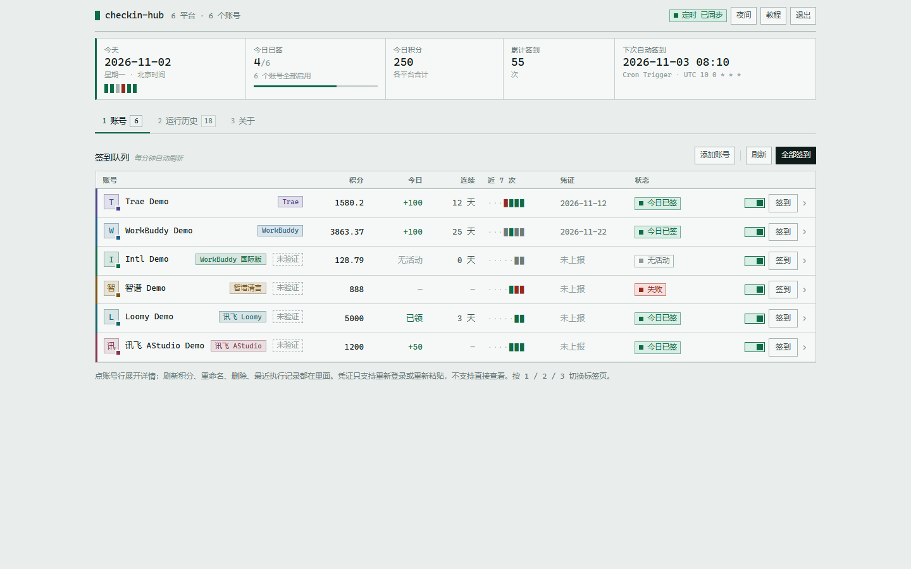
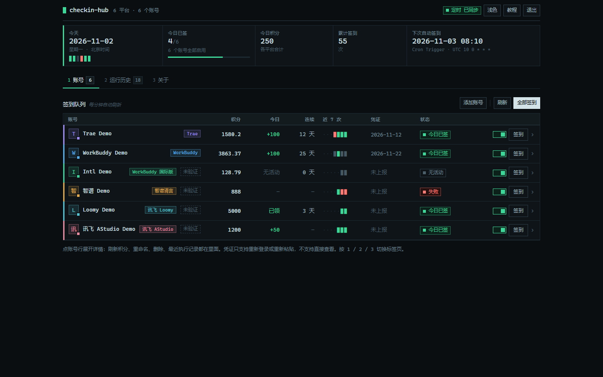
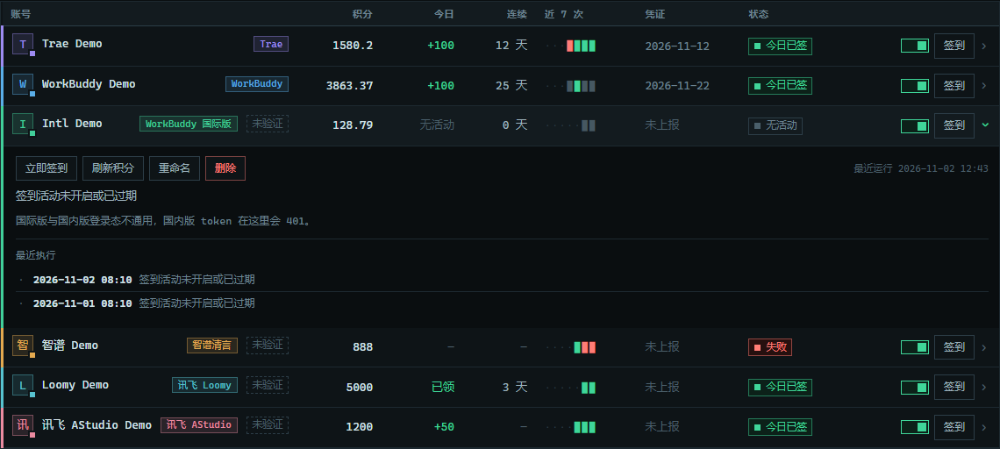
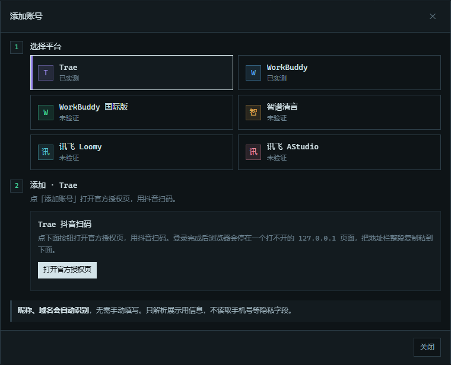

<div align="center">

# 签到台 · AI 工具聚合签到

**六个 AI 工具的每日签到 / 领积分，合并成一个 Cloudflare Worker**

把每天要点的签到都搬到云端：**不用开电脑、不用装客户端、不用守时间**。
扫码或粘一次凭证把账号托管进去，之后 Worker 自己续期令牌、按时签到、记录结果。

<br>


<br>

| 浅色 | 深色 |
| :---: | :---: |
|  |  |

</div>

---

## 目录

- [特性一览](#特性一览)
- [一、部署](#一部署)
- [二、第一次打开](#二第一次打开)
- [三、添加账号](#三添加账号)
- [四、控制台](#四控制台)
- [五、定时任务](#五定时任务)
- [六、接口速查](#六接口速查)
- [七、常见问题](#七常见问题)
- [八、数据与兼容](#八数据与兼容)
- [九、安全设计](#九安全设计)
- [十、已知限制](#十已知限制)
- [十一、风险提示](#十一风险提示)
- [十二、仓库结构](#十二仓库结构)
- [十三、贡献](#十三贡献)
- [十四、许可证与免责声明](#十四许可证与免责声明)

---

## 特性一览

| 平台 | 签到内容 | 添加方式 | 状态 |
| --- | --- | --- | --- |
| **Trae** | 每日积分领取 | 抖音扫码 + 粘贴一次回调链接 | 已实测 |
| **WorkBuddy**（国内版） | 每日签到 | 微信扫码 | 已实测 |
| **Qoder**（国内版） | 每日活动领取 credits | 官网设备授权 | 未验证（按已实测版本移植） |
| **WorkBuddy 国际版** | 活动档期内每日领取 | Google / GitHub / X 网页授权，或粘贴 token | 未验证 |
| **智谱清言** | 每日登录积分 | 粘贴 `chatglm_token` | 未验证 |
| **讯飞 Loomy** | 每日额度池重置 | 粘贴 token | 未验证 |
| **讯飞 AStudio** | 每日登录积分 | 手机号 + 密码，或粘贴 Cookie | 未验证 |

七个平台都是 AI 编程 / AI 对话类产品，每天各点一次很碎。这里把它们合成一处：一套部署、一个控制台、一条定时任务，账号数据同存一个 KV，按平台前缀隔离，互不影响。

- **单文件**：全部代码在 `worker.js`，没有构建、没有依赖、没有 `import`，粘进 Cloudflare 网页控制台即可运行。
- **凭证加密**：每条账号记录用 AES-256-GCM 单独加密，密钥由 `MASTER_KEY` 经 HKDF 按平台派生，KV 里读不到明文。
- **定时自感知**：Cron 被唤醒过一次后，控制台直接显示真实的 Cron 表达式和下次签到时间；没唤醒过只说「待触发」，不谎报「已同步」。
- **签到台控制台**：今日日期戳 + 打孔考勤条 + 指标行，账号按平台色条和首字头像排成一本登记簿，行内可展开刷新积分、重命名、删除和最近执行记录；深色是默认值班台，右上角一键切浅色并记住选择。
- **签到结果通知**：Telegram Bot 和 QQ 官方机器人两个渠道，每轮全量签到跑完各推一条汇总；通道失败不影响签到结果。

---

## 一、部署

全程在 Cloudflare 网页控制台完成，不用装任何工具、不用命令行。

1. 打开 [Cloudflare Dashboard](https://dash.cloudflare.com/) → **Workers & Pages** → **Create**
2. 起个名字（例如 `signin-all`），创建后点 **Edit code**
3. 把 `worker.js` 全文粘进去 → **Deploy**
4. 回到 Worker 设置页，加下面这组绑定：

| 类型 | 名称 | 值 |
| --- | --- | --- |
| KV Namespace 绑定 | `KV` | 先到 **Storage & Databases → KV** 新建一个命名空间，回来选中它 |
| Secret | `MASTER_KEY` | 32 字节随机值的 base64，所有平台共用 |
| Secret | `ADMIN_TOKEN` | 你自己定的**页面登录密码** |
| Secret | `CRON_SECRET` | 可选。给 `/cron` 用的独立口令，不配则回落到 `ADMIN_TOKEN` |
| Secret | `CHATGLM_SIGN_SECRET` | 可选。覆盖智谱签名盐；默认值已内置，通常不需要配 |
| 变量 | `CHECKIN_CRON` | 可选。首次 Cron 触发前的展示占位，填 `08:10`；触发后自动读取 `event.cron` |

> `MASTER_KEY` 和 `ADMIN_TOKEN` 要建成 **Secret**，不是普通变量：变量在后台是明文可读的，还会留在部署历史里。已经建成变量的，删掉再以同名 Secret 填回**同一个值**就行——值不变，KV 里的账号数据不受影响。`MASTER_KEY` 一旦改动，已加密的凭证将再也解不开。

5. **Settings → Triggers → Cron Triggers** 加一条 `10 0 * * *`（= 北京时间 08:10）

生成主密钥：浏览器按 F12 打开控制台，粘贴执行

```js
btoa(String.fromCharCode(...crypto.getRandomValues(new Uint8Array(32))))
```

> 32 字节的 base64 一定是 **44 个字符、以 `=` 结尾**。长度不对就是复制漏了。

> `MASTER_KEY` 丢了 = KV 里的令牌全部解不开，只能重新扫码/重新粘贴。**存进密码管理器。**

### 让 Cloudflare 跟着 GitHub 仓库自动部署（可选）

仓库里只有模板 `wrangler.toml.example`，没有 `wrangler.toml`。这种情况下直接跑 `npx wrangler deploy`，wrangler 找不到配置会退化成静态站点检测，报 `Could not detect a directory containing static files`。所以让部署命令自己先把配置生成出来，KV id 从环境变量注入：

| 设置项 | 值 |
| --- | --- |
| Build command | 留空即可 |
| Deploy command | `test -n "$KV_NAMESPACE_ID" && cp wrangler.toml.example wrangler.toml && sed -i "s/__KV_NAMESPACE_ID__/$KV_NAMESPACE_ID/g" wrangler.toml && npx wrangler deploy` |
| Environment variables | `KV_NAMESPACE_ID`（勾选加密）＝ 你的 KV 命名空间 id |

生成配置写在 **Deploy command** 而不是 Build command，是因为 Workers Builds 在 Direct Deploy 模式下不跑构建命令，日志里只有 `Executing user deploy command`，配置根本不会被生成；写在部署命令里两种模式都能用。开头的 `test -n` 保证忘配环境变量时立刻失败，而不是留下一个空 id 的配置让 wrangler 报半句看不明白的话。

三个坑：

- 模板里的 `name = "signin-all"` 必须等于这个 Builds 项目对应的 Worker 名，否则部署会被拒或者多建一个 Worker。名字不一样就在 `sed` 后面再接一条：`&& sed -i 's/^name = .*/name = "你的名字"/' wrangler.toml`。
- `wrangler deploy` 每次都拿配置文件覆盖远程绑定，网页后台手加的 KV 绑定会被冲掉——KV id 只能写在配置里。
- Secret 不在配置文件里，`MASTER_KEY` / `ADMIN_TOKEN` 第一次仍要单独写入（`npx wrangler secret put` 或后台 Settings → Secrets），之后的部署不会动它们。

---

## 二、第一次打开

部署后拿到一个形如 `https://signin-all.<你的子域>.workers.dev` 的地址。

1. 打开它 → 输入 `ADMIN_TOKEN` → 点「登录」
2. 登录成功自动载入所有平台的账号列表，都是空的即为正常

登录状态记在本机浏览器（localStorage），下次打开自动登录。公共电脑用完点右上角「退出」。

控制台顶部有五个指标：

| 指标 | 含义 |
| --- | --- |
| 账号总数 | 所有平台账号数，下方显示启用数 |
| 今日已签到 | 已签 / 启用账号数，带进度条 |
| 今日获得积分 | 各平台今日到账合计（跨平台口径不同，仅供参考） |
| 累计签到 | 所有账号累计成功次数 |
| 下次自动签到 | 自动读取最近一次 Cloudflare Cron 触发的表达式，按北京时间计算 |

---

## 三、添加账号

控制台右上角 **「+ 添加账号」**，先选平台，再按提示操作。

### Trae：抖音扫码

1. 选 **Trae** → 点「打开官方授权页」
2. 用抖音扫码并确认
3. 浏览器会跳到一个**打不开的** `http://127.0.0.1:17388/authorize?…` 页面 —— 这是正常的，本机没有服务在监听
4. 在那个页面上按 `Ctrl+C` 复制地址栏（或直接全选地址栏复制），回到控制台**按一次 `Ctrl+V`** —— 输入框收到内容就会自动绑定

链接里带着一次性授权码（`AuthCode`），Worker 拿它换 refreshToken 并加密入库。整个过程不需要在本机跑任何程序，粘一次就完成，之后靠 refreshToken 自动续期。

授权链接 15 分钟内有效，`AuthCode` 只能用一次；粘错了重新点一次扫码即可。

**为什么不能全自动**：Trae 只把授权码回送到 `127.0.0.1` 上的某个端口，也就是**你自己电脑**。云端 Worker 没法访问你电脑上的端口，跨域也读不到那个弹窗的地址栏，Trae 又没有设备码授权可以绕开回调，所以最后这一下只能由浏览器里的人来完成。

> 设备密钥（ECDSA P-256）由 Worker 现场生成并加密保存，续期时的设备证明也由自己签名——**不需要装 Trae 客户端**。

### WorkBuddy 国内版：微信扫码

1. 选 **WorkBuddy** → 点「打开登录页」
2. 新窗口打开官方登录页（`www.codebuddy.cn/login`），二维码**由官方页面渲染，本服务不接触你的微信信息**
3. 微信扫码 → 手机上点确认
4. Worker 轮询到授权结果 → 令牌加密存进 KV → 账号自动出现在列表里，登录窗口会自动关闭

二维码有效期约 5–6 分钟，超时点「添加账号」重试。

> **为什么整页打开而不是嵌在控制台里**：官方登录页响应头带了 `frame-ancestors 'self'`，禁止被第三方页面内嵌，硬塞进 iframe 只会是一片空白。所以改成在新窗口打开。

### WorkBuddy 国际版：网页授权或粘 token

国际版（`www.workbuddy.ai`）和国内版**登录态不通用**，账号是 Google / GitHub / X 授权的。

- **方式一（推荐）**：选 **WorkBuddy 国际版** → 点「用 Google / GitHub 登录」，在官方授权页登录完，账号自动入库
- **方式二**：把 `access_token` 粘到弹窗里的输入框，点「确认添加」

> 活动按档期开放。没有档期时领取接口返回 `10001 签到活动未开启或已过期`，页面会显示「无活动」，这不是凭证失效，也不会反复重试。

### 智谱清言：粘 chatglm_token

1. 浏览器登录 `chatglm.cn`
2. 按 F12 → Application / Storage → Cookies，复制 `chatglm_token` 的值
3. 选 **智谱清言**，粘到 `access_token`，有 `chatglm_refresh_token` 一并填上；`device_id` 可留空（自动派生固定值）
4. 点「确认添加」

> **签名盐已内置**。智谱接口的请求头带客户端签名：
> `X-Timestamp`（毫秒时间戳，倒数第二位被校验位替换）、`X-Nonce`（随机 UUID v4）、
> `X-Sign = md5(ts-nonce-secret)`。签名盐是官方网页客户端里的固定常量，本项目已内置当前值；
> 如果客户端更新导致签名失败，再给 Worker 配 Secret `CHATGLM_SIGN_SECRET` 覆盖即可。

### 讯飞 Loomy：粘 token

1. 登录 Loomy 客户端或网页
2. 从请求头 / Cookie 里取 `token`
3. 选 **讯飞 Loomy**，粘到 `access_token`，点「确认添加」

> Loomy 的「签到」是**触发每日额度池重置**，不是「+5000 积分」。页面会把每日池、剩余、已用写在状态说明里。

### 讯飞 AStudio：手机号密码或 Cookie

**方式一（推荐）**：选 **讯飞 AStudio** → 「手机号密码」→ 输入 11 位手机号和讯飞账号密码 → 「登录并添加」。

- 密码只在本次请求的内存里用一次换会话，**不落盘、不进日志**
- 如果讯飞侧要求滑块（通常是密码输错过一次触发的），会提示改用 Cookie
- 登录成功后会先查一次余额验活，再入库

**方式二**：浏览器登录 AStudio → F12 → Network → 任意请求 → 复制完整 `Cookie`，选「粘贴 Cookie」填到 `session`。只填 `token` 值时程序会自动拼成 `Cookie: token=…`。

### 备注名

账号的**备注名优先取自账号昵称**；取不到时是平台名 + 随机后缀。点账号行展开详情 → 「重命名」，就地改，回车保存，`Esc` 放弃。每个平台、每个账号互不影响。

---

## 四、控制台

控制台是一页「考勤登记簿」，样式编译后内联在 Worker 里，不请求任何外部资源：

- **状态条**：北京时间的日期戳 + 一排打孔条（每个账号一个孔，绿=已签、红=失败、灰=停用/待签）+ 已签数、今日积分、累计签到、下次自动签到四格指标和一条进度线；最后一格写明排班来源（`Cron Trigger · UTC …` / `CHECKIN_CRON · 每天 …`）
- **账号列表**：左侧平台色条 + 首字头像 + 平台标签；八列依次是积分、今日、连续、近 7 次、凭证、状态、启用开关、签到。今天拿到积分显示 `+N`，签成功但平台不回传数字显示「已领」，凭证没有到期时间显示「未上报」；「近 7 次」一格一次执行，绿=拿到积分、灰=执行但无变化、黄=限流/冷却、红=失败、`·`=没跑过
- **展开详情**：点账号行展开，里面有「立即签到 / 刷新积分 / 重命名 / 删除」和最近 5 次执行记录
- **运行历史**：按时间倒序，显示账号、平台、触发方式、结果、积分、说明；支持分页和清空
- **关于**：支持平台、部署绑定、安全设计、已知限制
- **使用教程**：快速开始、Trae / WorkBuddy、国际版 / 智谱 / 讯飞、隐私与安全
- 视觉是柔和的卡片风：16px 圆角、轻阴影、radial 光晕 + 网格背景、`rise` 错峰入场，正文无衬线、数字和状态标签用等宽；深色默认、右上角切换并记住选择
- 「积分」列的口径按平台区分：Trae / 国际版 / 智谱 / Loomy / AStudio 显示接口返回的余额；**WorkBuddy 国内版接口只返回「本期签到累计」，没有余额字段**，这一列会退回显示本期累计并把鼠标悬停说明改成对应口径；Qoder 没有余额接口，只记本次和累计
- 等宽字体单栏 1440px，窄屏下状态条折成两列、账号表横向滑动而不是折行；`1` / `2` / `3` 切换标签页，`Esc` 关弹窗；样式在部署时编译内联，页面零外部资源

| 展开账号行 | 添加账号 |
| :---: | :---: |
|  |  |

### 状态标签

| 标签 | 含义 |
| --- | --- |
| 今日已签 | 今天签上了；「今日」列有数字就显示 `+N`，平台不回传数字则显示「已领」 |
| 待签 | 今天还没跑，或还没到定时时间 |
| 限流 N 分钟 | 服务端返回限流，Worker 已按账号冷却，到点后下一轮自动重试 |
| 待确认 | 提交成功但服务端未回执到账，下一轮会再查一次 |
| 无活动 | 平台明确返回当前没有活动档期（如 WorkBuddy 国际版 10001） |
| 失败 | 请求出错，下方显示原因 |
| 令牌失效 | 凭证失效，需要重新扫码/重新粘贴 |
| 已停用 | 账号开关关闭，不参与定时和批量签到 |

> 所有状态都由**当天**现算（按北京时间），不存在「昨天签过、今天还显示已签」的情况。

### 凭证有效期

| 显示 | 含义 |
| --- | --- |
| 日期 / N 天后 | 凭证到期时间 |
| 可续期 | WorkBuddy 国际版 / Trae 的 access token 已过期，但有 refresh token，下一次运行会自动续期 |
| 已过期 | 刷新链路也失效，需要重新登录/重新粘贴 |

### 刷新积分

顶部「刷新」会对所有启用账号做一次只读查询：Trae / WorkBuddy 会先续期再查状态和余额；国际版查活动状态 + 余额；Qoder 重查活动列表确认今天是否已领；智谱 / Loomy / AStudio 查余额。刷新不会签到，也不会重复加分。

### 签到结果通知

顶栏「通知」里配置，两个渠道各自独立，填完点「发测试」立刻验证：

| 渠道 | 需要填 | 说明 |
| --- | --- | --- |
| Telegram | Bot Token、Chat ID | 找 [@BotFather](https://t.me/BotFather) 建 bot；先给 bot 发一条消息，再查 `getUpdates` 拿 `chat.id` |
| QQ 官方机器人 | AppID、AppSecret、OpenID | 到 [q.qq.com](https://q.qq.com) 建机器人；OpenID 用页面里的命令在你本机取 |

取 QQ OpenID 不需要域名备案，页面弹窗会把命令按你当前地址生成好，复制执行即可：

```bash
# Windows 用 cmd（PowerShell 里 curl 是别名，不认 -O）
curl.exe -O https://你的域名/qq/openid-helper.mjs && node openid-helper.mjs <AppID> <AppSecret>
# macOS / Linux
curl -O https://你的域名/qq/openid-helper.mjs && node openid-helper.mjs <AppID> <AppSecret>
```

脚本要求 Node 22+（自带 WebSocket），连上网关后 60 秒内用手机 QQ 私聊一次机器人，就会打印 `user_openid`。填回页面保存。

每轮跑完（定时或「全部签到」）推一条汇总，形如：

```
📋 签到完成 · 11-02 08:10
✅ Trae · 1/1 · 新签 1
   · 我的号 +100 积分
✅ WorkBuddy · 1/1 · 已签 1
⚠️ Qoder · 1/2 · 失败 1
   · 备用号 refreshToken 已失效，请删掉重新添加
```

通道全部失败只会在 `/api/notify/test` 的返回里报错，不影响签到本身。

---

## 五、定时任务

**Cloudflare 的 Cron 只认 UTC。** 左列是填进 Cloudflare 的值，右列是北京时间：

| 设置 | Cron（填这个） | 对应北京时间 | 作用 |
| --- | --- | --- | --- |
| **必设一条** | `10 0 * * *` | **08:10** | 每天所有平台各跑一遍 |
| 选填 | `20 16 * * *` | 次日 **00:20** | 多一次机会，失败能自动补 |

**只设一条完全够用**：每次触发里所有平台会依次各跑一遍，不是每个平台各配一条。

第二条的意义是「一天两次机会」，而且对 Trae 尤其有用：

- 北京时间 0 点前后是 Trae 的**早窗**，限流冷却只按 12 分钟算；白天则要 55 分钟
- 也就是说 00:20 那趟如果撞上 9074，08:10 那趟大概率能补上
- 只留 08:10 一条也不会签不上，只是撞限流时当天没有第二次自动机会，得手动点一下

> 签到接口幂等（今天已签会直接返回"已签"，不重复加分），所以两条 cron 都留着、或者手动多点几次，都安全。

改时间：**Settings → Triggers → Cron Triggers**。

> 换算公式：**北京 = UTC + 8**。例如北京时间早上 9 点写成 `0 1 * * *`。
>
> 页面上的「下次自动签到」会在每次 Cloudflare Cron 触发时读取 `event.cron`，自动记录最近使用的 Cron 表达式并计算下一次时间（北京时间）；多条 Cron 会全部展示并取最近的一次。

### 右上角那枚定时角标只有三种说法

Worker 读不到 Cloudflare 后台的 Cron 列表——它只在自己被唤醒时收到 `event.cron`。所以角标不猜，只说三种事实：

| 角标 | 含义 | 你要做什么 |
| --- | --- | --- |
| **定时 已同步** | 至少被 Cloudflare 唤醒过一次，表达式是从真实触发里记下来的 | 什么都不用做 |
| **定时 待触发 08:10** | 后台配了排班或设了 `CHECKIN_CRON`，但 Worker 还没被唤醒过 | 等第一次自动触发，或手动点一次「全部签到」验证链路 |
| **定时 未配置** | 既没被唤醒过，也没有任何排班声明 | 去 **Settings → Triggers → Cron Triggers** 加一条 |

「待触发」不是错误：定时任务照样会跑，只是页面在此之前无法证明它跑过。第一次自动唤醒之后，这一格会自动变成「已同步」。

### 改用外部定时器（选填）

不想用 Cloudflare 自带 cron，或者想把签到并进已有的定时任务，可以从外面调 `/cron` 接口——跑的逻辑和「全部签到」一样。

```bash
curl -X POST "https://signin-all.你的子域.workers.dev/cron" \
  -H "X-Cron-Secret: 你的CRON_SECRET"
```

```bash
# 也可以放 query（GET / POST 都行）
curl "https://signin-all.你的子域.workers.dev/cron?key=你的CRON_SECRET"
```

返回各平台各自的汇总（WorkBuddy 同时保留旧版 `wb` 键）：

```json
{
  "at": "2026-11-02T08:10:00.000 +08:00",
  "trae": {
    "at": "2026-11-02T08:10:01.000 +08:00",
    "accounts": 1,
    "checked": 1,
    "already": 0,
    "failed": 0,
    "cooling": 0,
    "results": [
      { "id": "ab12cd34", "label": "我的号", "state": "checked", "msg": "+100 积分", "credit": 100 }
    ]
  },
  "workbuddy": {
    "at": "2026-11-02T08:10:03.000 +08:00",
    "accounts": 1,
    "checked": 0,
    "already": 1,
    "failed": 0,
    "cooling": 0,
    "results": [
      { "id": "CSl88KP2yXIn", "label": "我的主号", "state": "already", "msg": "今日已签" }
    ]
  },
  "wb": { "...": "同 workbuddy，兼容旧版" },
  "workbuddy_intl": { "...": "..." },
  "zhipu": { "...": "..." },
  "loomy": { "...": "..." },
  "astudio": { "...": "..." }
}
```

- `checked` 这次真签上了；`already` 今天已经签过；`failed` 失败或令牌失效
- `noActivity` 当前没有活动档期（不是失败）；`cooling` 限流/冷却
- HTTP **401** = 口令不对；**500** = `CRON_SECRET` 和 `ADMIN_TOKEN` 都没配

GitHub Actions 示例：

```yaml
on:
  schedule:
    - cron: '10 0 * * *'        # UTC 00:10 = 北京 08:10
jobs:
  signin:
    runs-on: ubuntu-latest
    steps:
      - run: |
          curl -fsS -X POST "https://你的地址/cron" \
            -H "X-Cron-Secret: ${{ secrets.CRON_SECRET }}"
```

**注意**：这条接口只靠口令保护，别把带 `key` 的地址贴进公开仓库或聊天记录；怀疑泄露就换一个 `CRON_SECRET`。

> Cloudflare 的 cron 和 `/cron` **二选一即可**，两边都配也不会重复签到。

---

## 六、接口速查

所有管理接口都认三种口令写法：`X-Admin-Token: <token>`、`Authorization: Bearer <token>`、`?token=<token>`。

### 聚合接口

| 方法 | 路径 | 说明 |
| --- | --- | --- |
| GET | `/` | 控制台页面 |
| GET | `/api/ping` | 校验密码 |
| GET | `/api/meta` | 平台元数据、字段、可用状态、cron 展示值 |
| GET | `/api/overview` | 所有平台账号 + 今日统计 + 下次自动签到 |
| GET | `/api/history?limit=200` | 运行历史（最多 300 条） |
| POST | `/api/history/clear` | 清空运行历史 |
| POST | `/api/run-all` | 所有平台一起签，加 `?force=1` 强制重跑 |
| POST | `/api/platforms/run` | body `{"platform":"zhipu","force":true}`，只跑一个平台 |
| POST | `/api/accounts/sign` | body `{"platform":"...","id":"...","force":true}`，只跑一个账号 |
| POST | `/api/accounts/refresh` | body `{"platform":"...","id":"..."}`，只查余额/状态 |
| POST | `/api/refresh-all` | 刷新所有启用账号的余额/状态 |
| POST | `/api/accounts/add` | body `{"platform":"...","label":"...","creds":{...}}` |
| POST | `/api/accounts/remove` | body `{"platform":"...","id":"..."}` |
| POST | `/api/accounts/rename` | body `{"platform":"...","id":"...","label":"..."}`（最长 40 字） |
| POST | `/api/accounts/enable` | body `{"platform":"...","id":"...","enabled":false}` |
| GET | `/api/notify` | 读取通知配置（Telegram / QQ） |
| POST | `/api/notify` | 保存通知配置；字段留空表示沿用旧值 |
| POST | `/api/notify/test` | 用假数据向已配置的渠道各发一条测试汇总 |
| GET | `/qq/openid-helper.mjs` | 取 QQ 机器人 openid 的本机脚本（需要 Node 22+） |
| POST | `/cron` | 定时入口，口令走 `X-Cron-Secret` 或 `?key=` |

> `POST /api/accounts/add` 只用于「粘贴凭证」的平台；Trae / WorkBuddy 请走各自的扫码登录接口，Qoder 走设备授权。

### 平台命名空间（兼容旧路径）

| 前缀 | 平台 |
| --- | --- |
| `/trae/api/*` | Trae |
| `/wb/api/*` | WorkBuddy 国内版（旧路径，仍可用） |
| `/wbi/api/*` | WorkBuddy 国际版 |
| `/qoder/api/*` | Qoder 国内版 |
| `/zhipu/api/*` | 智谱清言 |
| `/loomy/api/*` | 讯飞 Loomy |
| `/astudio/api/*` | 讯飞 AStudio |

每个命名空间下都有 `GET /api/list`、`POST /api/run`、`POST /api/remove`、`POST /api/rename`、`POST /api/refresh`、`POST /api/enable`；支持粘贴凭证的平台还有 `POST /api/add`，国际版还有 `POST /api/login/start` / `GET /api/login/poll`，AStudio 还有 `POST /api/login/password`，Qoder 还有 `POST /api/login/start`（返回 `nonce` 与授权页地址）/ `GET /api/login/poll?nonce=`。

Trae 的扫码接口仍为：

| 方法 | 路径 | 说明 |
| --- | --- | --- |
| POST | `/trae/api/login/start` | 生成抖音授权链接，无需 body |
| GET | `/trae/api/login/poll?trace=` | 查询扫码结果 |
| POST | `/trae/api/login/claim` | 粘贴回调链接完成绑定，body `{"url":"..."}` |

WorkBuddy 扫码接口仍为 `/wb/api/login/start`、`/wb/api/login/poll?state=`；国际版为 `/wbi/api/login/start`、`/wbi/api/login/poll?state=`。

> `force=1` 只是跳过"今天签过就不请求"的本地判断，服务端本身幂等，不会重复加分。

---

## 七、常见问题

| 现象 | 原因 | 处理 |
| --- | --- | --- |
| 登录提示「登录密码不正确」 | `ADMIN_TOKEN` 填错 | 检查有没有多打空格 |
| 提示 `未配置 ADMIN_TOKEN` | 这个 Secret 没建 | 补建，名字要**完全等于** `ADMIN_TOKEN` |
| 提示 `缺少 MASTER_KEY` | Secret 没建或名字拼错 | 名字要**完全等于** `MASTER_KEY` |
| 提示 `MASTER_KEY 必须是 32 字节` | 主密钥复制不全 | 重新生成，确认 44 字符且以 `=` 结尾 |
| 提示 `MASTER_KEY 不是合法 base64` | 粘进了换行或引号 | 只复制字符串本身 |
| 提示 `未绑定 KV：…变量名填 KV` | KV 没绑或绑定名写错 | 绑定名必须**完全等于** `KV` |
| 智谱签名失败 | 客户端签名盐更新 | 用 Secret `CHATGLM_SIGN_SECRET` 覆盖默认值 |
| 智谱只能粘贴 token | 智谱没有手机号登录入口 | 从浏览器 Cookie 取 `chatglm_token` 粘贴 |
| WorkBuddy 国际版显示「无活动」 | 当前没有活动档期（10001） | 不是失败，等档期开放；凭证是好的 |
| 国际版粘国内版 token 报 401 | 两站登录态不通用 | 换用 `www.workbuddy.ai` 的 token / 授权 |
| AStudio 密码登录提示要滑块 | 讯飞风控（通常密码输错过一次） | 改用「粘贴 Cookie」 |
| AStudio 提示「验证凭证失败 / 凭证无效」 | Cookie/token 无效 | 重新复制完整 Cookie |
| Loomy 显示「每日池 5000」但今日 +— | Loomy 是额度池重置，不是加积分 | 正常现象 |
| 新平台显示「未验证」 | 协议按官方客户端/网页整理，尚未在 Worker 环境用真实账号跑通 | 接口可能随客户端升级变化，先小号试用 |
| Trae 扫码后停在「无法访问此网站」 | 正常现象，官网只回送 127.0.0.1 | 复制该页地址栏的整段链接，回控制台按一次 `Ctrl+V` |
| Trae 登录页报「网络错误」 | 打开的不是控制台生成的链接 | 回控制台重新点「添加账号」，别手改链接里的回调地址 |
| 粘贴后报「地址里没找到 authCodeInfo / code」 | 复制时漏了 `?` 后的部分 | 先把地址栏全选再复制 |
| Trae 显示「限流 N 分钟」 | 服务端 9074 限流 | 等冷却结束，下一轮自动重试；加一条 00:20 的 cron 更容易补上 |
| Trae 显示「令牌失效」 | refreshToken 失效 | 重新扫码 |
| WorkBuddy 登录窗口是空白页 | 浏览器把 `about:blank` 当广告拦了 | 重新点一次；仍空白就点提示里的链接直接打开 |
| 提示「登录会话已过期」 | 二维码超过有效期没扫 | 重新扫码 |
| 账号显示「已停用」 | 开关被关掉 | 点行内开关恢复 |
| 刷新后显示「令牌失效」 | 刷新链路也失效 | 重新扫码/重新粘贴 |
| 同一账号出现两条 | 用不同凭证重复添加，且平台没有 uid 可去重 | 删掉多余的一条即可 |
| 一直没动静 | cron 没配 / 时区搞错 | 检查 Triggers 里那条 cron，注意填的是 UTC |
| `/cron` 返回 401 | `key` / `X-Cron-Secret` 填错 | 口令须等于 `CRON_SECRET`，没配时回落到 `ADMIN_TOKEN` |

排查看实时日志：Worker 详情页的 **Logs**。

---

## 八、数据与兼容

### 已有 Trae / WorkBuddy 账号

**不用重新添加**。原有 KV 前缀、加密 info、账号字段都没改：

| 平台 | KV 前缀 | 加密 info |
| --- | --- | --- |
| Trae | `trae:` | `trae-signin/v1/account` |
| WorkBuddy | `wb:` | `wb-signin/v1/account` |
| WorkBuddy 国际版 | `wbi:` | `wbintl-signin/v1/account` |
| 智谱清言 | `zhipu:` | `zhipu-signin/v1/account` |
| 讯飞 Loomy | `loomy:` | `loomy-signin/v1/account` |
| 讯飞 AStudio | `astudio:` | `astudio-signin/v1/account` |

老账号没有 `enabled` 字段的按「启用」处理；第一次刷新/签到后会补齐新字段。

### 运行历史

存 KV 键 `history:runs`，最多保留 300 条。每次手动签到、批量签到、定时任务都会写入；清空按钮只删历史，不动账号和凭证。

### 备份

KV 里是密文，备份 KV 时务必同时保存 `MASTER_KEY`。**换了 `MASTER_KEY` 旧记录全部解不开**，只能重新扫码/重新粘贴。

---

## 九、安全设计

- KV 里存的是 **AES-256-GCM 密文**：每条记录自带随机 salt 与 IV，密钥由 `MASTER_KEY` 经 **HKDF-SHA256** 派生
- KV 中永远不出现明文令牌；接口任何响应都不返回令牌、Cookie、私钥，连前缀都不给
- 登录密码与账号令牌分离——泄露登录密码不等于泄露账号
- 口令比较走定长比较，避免时序侧信道
- 登录密码只存在浏览器 localStorage，Worker 侧不落盘、不下发 Cookie
- AStudio 的密码只在单次请求内存里换会话，**不保存、不写日志**
- 页面零外部资源引用，不加载任何第三方脚本或字体
- 新增平台使用各自的加密 info，即使某个平台的密文被解开，也不会影响其它平台

> 边界：令牌在 Worker 内存里必然有一刻是明文。云端能看到什么取决于你是否信任它——介意就部署到自己的账号下。

---

## 十、已知限制

1. **除 Trae / WorkBuddy 外，平台接口都是逆向得到的**，客户端升级可能改路径或参数，届时需要跟进适配；页面会把未验证平台标出来
2. **智谱的签名盐已内置当前客户端常量**；如果官方客户端更新导致签名失败，用 `CHATGLM_SIGN_SECRET` 覆盖即可
3. **只做签到/领积分**，没做成长中心那套（连登奖励、兑换、盲盒、玩法等）——那些接口参数更复杂、变动更频繁
4. **WorkBuddy 国际版活动按档期开放**，没档期时显示「无活动」，不是故障
5. **AStudio 密码登录可能被滑块拦截**，此时只能粘贴 Cookie
6. **Trae 的授权码只能落到 127.0.0.1**，所以加账号的最后一步要手动粘贴一次回调链接；一个账号只需做一次，之后靠 refreshToken 自动续期
7. **扫码依赖官方登录页**，登录页改版或官方对非客户端来源做限制时可能失效
8. 免费额度绰绰有余：Workers 10 万请求/天，KV 10 万读 / 1000 写 / 天——一天跑一两次，连零头都用不到

---

## 十一、风险提示

本项目为非官方工具，与 Trae、WorkBuddy、智谱、讯飞及其所属公司均无任何隶属关系。签到接口从各自客户端/网页逆向得到，使用风险自负。

自动化签到可能涉及服务条款问题。**建议只给自己的账号用，不要做多账号刷积分**——规模一大更容易被风控识别。项目提供多账号能力是为了方便管理你自己的号，不是鼓励滥用。

---

## 十二、仓库结构

```
.
├── worker.js                # 全部代码：六个平台 + 控制台 + 定时任务，单文件
├── wrangler.toml.example    # 可选：用命令行部署时的绑定模板
├── docs/screenshots/        # 文档截图（演示数据，不含真实账号）
├── LICENSE                  # MIT
├── SECURITY.md              # 漏洞报告方式
└── CONTRIBUTING.md          # 新增平台适配器的约定
```

`worker.js` 内部按模块从上到下分八段：公共工具与加密 → Trae 适配 → WorkBuddy 国内版适配 → Qoder 国内版适配 → 通用令牌平台工厂（智谱清言 / 讯飞 Loomy / 讯飞 AStudio / WorkBuddy 国际版都由它生成）→ 外壳（平台注册表 / 聚合接口 / 通知 / 定时任务）→ 控制台页面 → `fetch` / `scheduled` 入口。


---

## 十三、贡献

- 加一个新平台，只需要写一个适配器对象（`meta` / `normalize` / `prepare` / `urls` / `headers` / `parseStatus` / `parseClaim` 等钩子），聚合层、加密、控制台、定时任务都不用改。
- 本地跑起来：`npx wrangler dev`，或者直接把 `worker.js` 粘进 Cloudflare 网页控制台的编辑器。
- 提 PR 前请确认 `node --check worker.js` 通过，并说明新平台接口是否用真实账号验证过——**没验证过的平台会在页面上标「未验证」，请如实标注**。
- 详细约定见 [CONTRIBUTING.md](CONTRIBUTING.md)，安全问题请先按 [SECURITY.md](SECURITY.md) 私下报告。

---

## 十四、许可证与免责声明

本项目以 **MIT** 许可证开源，详见 [LICENSE](LICENSE)。

本项目是非官方工具，与 Trae、WorkBuddy、智谱、讯飞、Qoder 及其所属公司均无任何隶属、背书或合作关系。平台名称与商标归各自权利人所有。使用者需自行确认自动化行为是否符合相关服务条款，作者不对账号被风控、积分被回收或任何直接或间接损失承担责任。

参考仓库：<https://github.com/ggzhzc/workbuddy-trae-checkin>。

